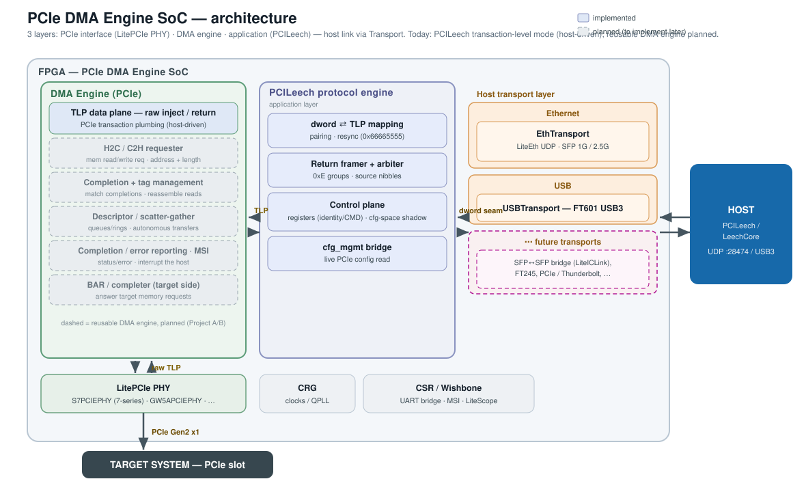

# PCIe DMA Engine SoC

Open, multi-board **PCIe DMA gateware built on LiteX**, aiming to be **compatible with the
[PCILeech / LeechCore](https://github.com/ufrisk/pcileech) host tools**.

This project is the continuation of the original *PCIe Screamer* example design, generalized so
that the same gateware can target many LiteX-supported boards (not just Artix-7) and reach the host
over several transports (USB, Ethernet, ...), while staying compatible with the PCILeech toolchain.

> Status: work in progress. The legacy FT601/USB3 boards build today; the PCILeech-compatible
> fast-path, the Ethernet transport and the new boards are being added. See the design document:
> [`doc/pcileech_porting_analysis.md`](doc/pcileech_porting_analysis.md).

## Architecture



The SoC is split along clean seams so new boards and host links can be added without touching the
shared logic:

- **PCIe PHY** — LitePCIe (Xilinx 7-series today; other families planned).
- **Host transport** — a pluggable link to the host (FT601/USB3 today; Ethernet/UDP and others
  planned).
- **Shared SoC** — TLP path, MSI and the optional LiteScope analyzer.

## Supported boards

| `--board`              | FPGA                 | Transport              | Status      |
|------------------------|----------------------|------------------------|-------------|
| `pcie_screamer`        | Xilinx Artix-7 35T   | FT601 USB3             | Building    |
| `pcie_screamer_m2`     | Xilinx Artix-7 35T   | FT601 USB3             | Building    |
| `acorn_baseboard_mini` | Xilinx Artix-7 200T  | Ethernet/UDP (SFP)     | In progress |

(`pcie_screamer` / `pcie_screamer_m2` name the original LambdaConcept boards; `acorn_baseboard_mini`
is the SQRL Acorn CLE215+ on the LiteX Acorn Baseboard Mini, reaching the host over the SFP cage as
1G or 2.5G Ethernet — select with `--eth-speed {1G,2.5G}`.)

## Getting started

Install the LiteX ecosystem (Migen, LiteX, LitePCIe, LiteEth, LiteScope, ...):

```sh
$ wget https://raw.githubusercontent.com/enjoy-digital/litex/master/litex_setup.py
$ chmod +x litex_setup.py
$ ./litex_setup.py init
$ sudo ./litex_setup.py install
```

### Build the FPGA bitstream

```sh
$ ./build.py --board pcie_screamer --build
```

### Load the FPGA bitstream

```sh
$ ./build.py --board pcie_screamer --load
```

`./build.py` is the build entry point. Use
`--board pcie_screamer_m2` (or the `--m2` alias) for the M2 variant, and `--with-analyzer` /
`--with-loopback` as needed. Run `./build.py --help` for all options.

### Elaboration smoke test

Elaborate every supported board (no vendor toolchain required) to catch regressions:

```sh
$ python test/test_elaborate.py
```

## Software support

The gateware targets compatibility with the PCILeech / LeechCore host tools; see
[`doc/pcileech_porting_analysis.md`](doc/pcileech_porting_analysis.md) for the protocol analysis and
roadmap.

## History & credits

Derived from the *PCIe Screamer* example design by EnjoyDigital and LambdaConcept
(Copyright (c) 2016-2020). Powered by [Migen](https://github.com/m-labs/migen) &
[LiteX](https://github.com/enjoy-digital/litex). PCILeech / LeechCore are by Ulf Frisk.
