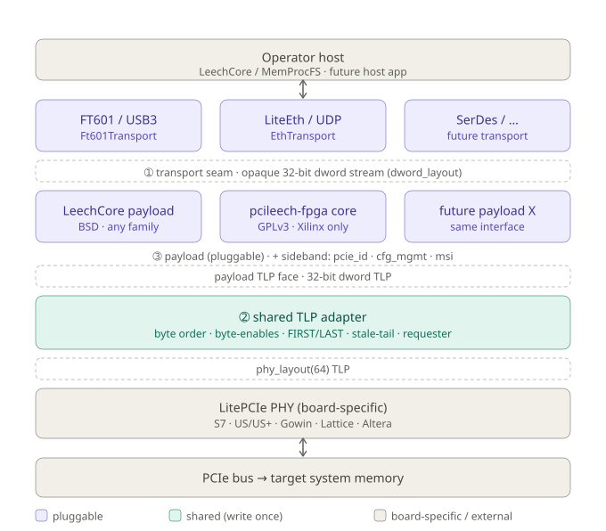

# ADR 0001 — Unified TLP architecture: pluggable transports and payloads

Status: **Accepted** (direction agreed; implementation staged — see §7).
Supersedes: the two divergent stacks described in §2.
Related: [`doc/pcileech_porting_analysis.md`](pcileech_porting_analysis.md) (the PCILeech wire contract).

## 1. Context

The project must carry PCIe TLPs to a host over **several interchangeable links** — FT601/USB3,
raw UDP over Ethernet, and others later (FT245, SerDes/LiteICLink, PCIe-to-PCIe, …) — and the host
application on the far end should itself be **swappable**. Today "the application" is
PCILeech/LeechCore, but it should be just one *payload*; future payloads (a custom DMA bridge, a
TLP fuzzer, a LitePCIe DMA endpoint, …) must ride the same plumbing without touching the transports
or the PCIe PHY.

Two forces shape the design:

- **Family independence.** The PCIe PHY is the only board-specific part and is provided by LitePCIe
  across families (Xilinx 7-series/US/US+, Gowin GW5A, Lattice LFCPNX, Altera C5, …). The TLP data
  plane above it must stay family-neutral.
- **Reuse of the LeechCore FPGA implementation** (pcileech-fpga) where it helps security and
  maintenance — without importing its constraints everywhere (it is GPLv3, and its TLP module is
  tied to the Xilinx PCIe AXIS). This repo is BSD-2-Clause.

## 2. The problem with the current code

Two stacks grew in parallel and do **not** share a seam:

| | Transport | Application | TLP path |
|---|---|---|---|
| Legacy (`pcie_screamer`, `pcie_screamer_m2`) | `USBTransport` (FT601) | **bakes in** Etherbone (Wishbone) + a raw-TLP bridge | `gateware/tlp.py` (EnjoyDigital) |
| New (`acorn_baseboard_mini`, on branch `acorn-cle215-mini`) | `EthTransport` (LiteEth/UDP) | `PCILeechEngine` (LeechCore protocol) | inside `PCILeechEngine` |

- `EthTransport` already exposes a clean **opaque 32-bit dword stream** (`sink`/`source` of
  `dword_layout()`) — a transport that knows nothing about its payload.
- `USBTransport` instead *is* its payloads: it instantiates Etherbone and the raw-TLP bridge
  internally, so no other payload can run over USB and the LeechCore payload cannot run over USB.
- The TLP correctness logic (byte-enables, byteswap, FIRST/LAST framing, odd-length "stale tail")
  lives **inside** `PCILeechEngine`, so a second payload would have to re-derive it — and the
  Acorn bring-up proved these are exactly the subtle, hardware-only bugs worth centralising
  (see §4 and `doc/hardware_validation.md` on the Acorn branch).

## 3. Decision — four layers, three contracts

Adopt the layering pcileech-fpga itself uses (its `pcileech_com` is a single dword FIFO behind
which FT601/ETH are compile-time choices), expressed as explicit LiteX module contracts:



A new transport, a new payload, or a new board each touches exactly one band, never the others.
(Plain-text rendering of the same diagram:)

```
  board-specific                 ┌───────────────────────────┐
  ┌────────────────┐             │  Transport PHY            │  FT601 · LiteEth · SerDes · …
  │  LitePCIe PHY  │             └────────────┬──────────────┘
  │  S7/US/Gowin/… │                          │  ❶ TRANSPORT SEAM
  └───────┬────────┘                          │     dword_layout() sink + source
          │ phy_layout(64) TLP      ┌──────────▼─────────────┐
  ┌───────▼─────────────────┐      │  Transport adapter      │  EthTransport · Ft601Transport · …
  │  ❷ TLP ADAPTER (shared) │      └──────────┬─────────────┘
  │  byte order · byte-en · │                 │  (opaque dwords)
  │  FIRST/LAST · stale tail│     ┌───────────▼─────────────┐
  │  requester/completion   │◄TLP─┤  ❸ PAYLOAD (pluggable)  │  LeechCore engine (today) · future X
  └─────────────────────────┘ +sb │  + sideband (cfg/msi…)  │
                                   └─────────────────────────┘
```

### ❶ Transport seam
A transport is **only** a mover of opaque dwords. Contract:

- `source` : `stream.Endpoint(dword_layout())` — host → FPGA.
- `sink`   : `stream.Endpoint(dword_layout())` — FPGA → host.
- Owns link bring-up, MTU/segmentation, the `0x55556666` dword↔qword resync and any keepalive —
  all invisible to the payload.
- Exposes **no** payload-specific port (no Wishbone, no TLP). A transport must build and pass with
  a trivial loopback payload and with any conforming payload.

`EthTransport` already satisfies this (now fully opaque). `USBTransport` (FT601) is refactored to
match (the Etherbone and raw-TLP bridges move *out* of the transport; see §7). A third transport,
**USB3-over-SFP via [`usb3_pipe`](https://github.com/enjoy-digital/usb3_pipe)**, slots in the same
way (see §9): the Acorn CLE-215+ on the Baseboard Mini is `usb3_pipe`'s own main validation target,
reaching the host through an SFP2USB adapter over the *same* Artix-7 GTP this board uses for LiteEth —
so eth and usb3 are mutually exclusive per build, selected by a target variant.

### ❷ TLP adapter (shared, the heart of "unified TLP")
One module converts between the PHY's `phy_layout(64)` TLP stream and a 32-bit dword TLP stream,
and is the *single* home for the correctness rules the Acorn bring-up established:

1. **Inject, odd-length TLP** — force the last 64-bit beat's byte-enables to `0x0f`; a stale high
   dword turns a 3-DW MRd into 4 DW → the root port rejects it as a Malformed TLP (Fatal) and
   resets the link. (LiteX's `StrideConverter` only masks this when the data field is named
   `data`; litepcie's `phy_layout` names it `dat`.)
2. **Return byte order** — the S7PCIEPHY delivers *every* completion dword (header and payload)
   in one byte order; byte-swap all of them so LeechCore parses the header and the payload lands
   in host memory order.
3. **Return framing markers** — tag each returned dword's source nibble `{FIRST=bit3, LAST=bit2,
   port=bits[1:0]}`; LeechCore v4.13+ ignores any TLP whose first dword is not FIRST-marked.
   (Marker placement is a TLP-adapter concern; *which* nibble/port is a payload concern — see note.)
4. **Return stale tail** — on an odd-length completion the last beat holds one valid dword; drop
   the stale high dword (and retime `last`) or the completion is one dword too long and LeechCore
   rejects it (`cb != header Length`). Achieved by exposing the stream under a `data`-named layout
   so `StrideConverter`'s down-converter masking engages.

> Note on the layer split: items 1, 2, 4 are **pure TLP/PHY correctness** and belong wholly in ❷,
> reused by every payload and every family. Item 3's *mechanism* (per-TLP FIRST/LAST) is generic,
> but the *nibble encoding* is the LeechCore wire format; keep the generic first/last signalling in
> ❷ and let the payload stamp its own framing. The legacy `gateware/tlp.py` already implements the
> equivalent of 1 and 4 correctly (via `Converter(report_valid_token_count=True)` and a
> `be == 0xf` gate) — it is the reference for the BSD path and folds into ❷.

### ❸ Payload (pluggable application)
A payload is a module with two faces and optional sideband:

- transport face : `sink`/`source` of `dword_layout()` (to ❶).
- TLP face       : `tlp_sink`/`tlp_source` of `phy_layout()` via ❷ (to the PHY).
- sideband       : `pcie_id`, `cfg_mgmt`, `msi`, resets — named optional signals.

`PCILeechEngine` (LeechCore) is the first payload. Any future payload implements the same faces and
inherits every transport and every PHY family for free.

## 4. Decision — reuse strategy: **hybrid behind one payload interface**

`device_fpga.c` is host-side (nothing to lift); pcileech-fpga's device side is GPLv3 SystemVerilog,
and its protocol core (`pcileech_com`/`mux`/`fifo`) is portable while its TLP module
(`pcileech_tlps128`) is bound to the Xilinx PCIe AXIS. Therefore:

- **Default payload is BSD, migen, family-independent** — the `PCILeechEngine` path. It runs on any
  LitePCIe PHY and keeps the build BSD-clean.
- **Upstream HDL is an *optional* drop-in** for Xilinx boards that want bit-for-bit upstream parity:
  the same ❸ payload interface can be satisfied by a thin wrapper around pcileech-fpga's
  `com`/`mux`/`fifo` (GPLv3), isolated in its own directory with its own licence. It is never pulled
  into non-Xilinx or BSD-only builds.
- **Reuse that always applies, regardless of payload choice:** (a) *share protocol definitions*
  (command/dword formats, CMD-register bits, RO map, magics) with upstream via one checked header so
  the two ends cannot drift; (b) a *conformance test suite* that pins payload behaviour against what
  `device_fpga.c` actually sends/expects (the Acorn-branch `test/test_pcileech_engine.py` is the
  seed). This is where the security/maintenance value is banked without the licence/portability cost.

### Licensing boundary
BSD gateware and the optional GPLv3 wrapper live in **separate directories with explicit SPDX
headers**. A build selects at most one payload implementation; mixing GPLv3 HDL into a board taints
only that board's bitstream, never the BSD core.

## 5. Consequences

Positive: one transport contract (add a link once, every payload gets it); one place for TLP
correctness (fix once, every payload/family benefits); payloads are swappable and testable against a
loopback; the LambdaConcept boards reach pcileech/MemProcFS by reusing the Acorn's payload over a
refactored FT601 transport; family independence and the BSD licence are preserved; upstream parity
remains available where it is wanted.

Costs / risks: `USBTransport` must be refactored (behaviour-preserving for the legacy host tool is a
constraint, see §7); the TLP adapter extraction must not regress the Acorn's hardware-validated path;
the optional GPLv3 wrapper is extra surface to maintain and must be kept strictly isolated. None of
the FT601 changes can be hardware-validated here (no LambdaConcept board on hand) — they will be
sim- and build-checked, and flagged for on-hardware validation by someone with the board.

## 6. Current → target mapping

| Piece | Status |
|---|---|
| Transport seam | `EthTransport` is the ❶ contract, now fully opaque ✓ |
| FT601 transport | opaque `Ft601Transport` + `PcileechUsbSoC`; screamers build PCILeech over USB ✓ (build-validated; needs board). Legacy `USBTransport` kept for `--legacy` |
| TLP correctness | extracted to shared `gateware/tlp_adapter.py` (`TlpAdapter`, ❷) ✓ |
| Legacy TLP bridge | `gateware/tlp.py` — fold onto `TlpAdapter` pending |
| LeechCore app | `PCILeechEngine` landed as the first ❸ payload ✓ |
| Upstream HDL | not used — optional GPLv3 ❸ wrapper (Xilinx) pending |

## 7. Migration plan (staged, each independently shippable)

1. **This ADR** — agree the seams and the hybrid reuse strategy. *(done)*
2. **Land the LeechCore payload on the default branch.** Bring `PCILeechEngine` + the four ❷ fixes
   (validated on `acorn-cle215-mini`) into `dma-engine-soc`. *(done)*
3. **Extract the shared TLP adapter (❷).** Byte-enable / stale-tail / first-last and the return
   byte-order moved out of the payload into `gateware/tlp_adapter.py` (`TlpAdapter`), with its own
   unit tests; the payload re-points at it. Hardware-validated on the Acorn (pattern read byte-exact,
   identity intact). *(done; `gateware/tlp.py` adoption still pending — see below.)*
4. **Make the transport opaque (❶).** `EthTransport` now moves little-endian wire dwords verbatim in
   both directions; the LeechCore payload normalizes byte order at its own sink input, and the adapter
   byte-swaps the return path. Hardware-validated on the Acorn. *(done for Ethernet.)*
   **FT601/USB done too:** `Ft601Transport` (gateware/transport/usb.py) is an opaque `HostTransport`
   wrapping the FT601 FIFO (dword seam only); `PcileechUsbSoC` (gateware/soc.py) runs the LeechCore
   payload over it exactly as the Acorn does over Ethernet, and the `pcie_screamer` / `pcie_screamer_m2`
   targets now default to it (`--legacy` keeps the original Etherbone + raw-TLP host path, whose code is
   retained). Build-validated: `pcie_screamer` synthesizes to a bitstream (xc7a35t). *Not* hardware-
   validated — no LambdaConcept board on hand; on-wire FT601 flow-control/keepalive details need a board.
5. **Formalise the ❶ transport interface + a loopback payload.** `HostTransport`
   (`gateware/transport/base.py`) and `HostPayload`/`LoopbackPayload` (`gateware/payload.py`) now make
   the seam explicit; `EthTransport` and `PCILeechEngine` inherit them, and `connect_payload()` joins
   them. `test/test_payload_loopback.py` round-trips dwords through the seam with no PHY and no board —
   the sim harness any hardware-less transport reuses. *(done; folding `gateware/tlp.py` onto
   `TlpAdapter` still pending.)*
6. **Add the USB3-over-SFP transport (`usb3_pipe`).** `Usb3Transport` behind the ❶ seam + a board
   variant routing the GTP to the SFP for USB3; host shim bridging USB3 Bulk/CDC to localhost rawudp.
   Simulation-only until an SFP2USB adapter is available (see §9).
7. **(Optional) GPLv3 upstream wrapper** for Xilinx boards wanting upstream parity, isolated per §4.

> Byte-order ownership (as built): the **return** byte-swap (PHY-native → PCIe wire order) lives in
> the adapter (❷) and is payload-agnostic. The **inject** direction stays PHY-native through the
> adapter because its data dword doubles as a register value/mask in the command stream, so inject
> byte order is normalized once, with the command plane, at the payload's sink input — not split into
> the adapter. A fully symmetric wire-order payload (adapter byte-swapping both directions) would mean
> re-deriving the command parser in wire order and re-validating the whole connect handshake; deferred
> as not worth the risk for no functional gain.

## 8. Open items

- Exact keepalive/resync ownership at the seam for FT601 vs UDP (both use `0x55556566`-class
  markers; confirm per transport).
- Whether `gateware/tlp.py`'s whole-TLP buffering (level-based reframing) stays, or the generic
  first/last signalling from ❷ replaces it.
- CFG/shadow-config and DRP features (§ `pcileech_porting_analysis.md`) are payload concerns; decide
  per payload whether they are BSD-reimplemented or deferred to the GPLv3 wrapper.

## 9. USB3-over-SFP transport (`usb3_pipe`)

A planned third transport that connects the monitoring host over USB3 through an SFP2USB adapter,
in place of Ethernet — a strong validation of the "any transport behind one seam" goal, because it
reuses the LeechCore payload, the TLP adapter and the PCIe PHY unchanged.

Why it fits cleanly:

- [`usb3_pipe`](https://github.com/enjoy-digital/usb3_pipe) (EnjoyDigital, LiteX) ships both the USB3
  PHY (LFPS, training, 8b/10b, scrambling, LTSSM) **and a full USB3 device core** (link/protocol
  layers, control + **Bulk** + isochronous endpoints). A Bulk IN/OUT endpoint pair carries the opaque
  dword stream — exactly what the ❶ seam needs.
- Its **main development/validation target is the Acorn CLE-215+ on the LiteX Acorn Baseboard Mini**,
  reaching the host through an **SFP2USB adapter** over the board's Artix-7 **GTP** — the *same*
  transceiver this project already drives for LiteEth. So `Usb3Transport` and `EthTransport` are
  mutually exclusive per bitstream, chosen by a target variant (e.g. `--host-link {eth,usb3}`).
- Host side needs **no custom kernel driver** (standard `usbfs`/`cdc_acm` + Python).

Shape of the work:

- `Usb3Transport(Module)`: wrap `usb3_pipe`'s device core + a Bulk endpoint pair, expose only
  `dword_layout()` `sink`/`source`. No payload knowledge — same contract as `EthTransport`.
- Add `usb3_pipe` as a vendored dependency and a board variant that routes the GTP to the SFP for USB3
  instead of 1000BASE-X.
- **Host integration without a new LeechCore backend:** because the transport is opaque and the dword
  protocol is transport-agnostic, a tiny host shim can bridge the USB3 Bulk/CDC byte-pipe to localhost
  UDP, so `pcileech`/MemProcFS connect via `RAWUDP://ip=127.0.0.1` and reuse the existing, validated
  rawudp path. (A native LeechCore USB3 backend is a later option.)
- **No USB SFP module on hand → simulation only** for now, matching how FT601 is handled: validate the
  `Usb3Transport` dword seam against the loopback payload (ADR step 5) and build-check the variant;
  flag on-hardware bring-up for when an SFP2USB adapter is available. `usb3_pipe`'s own `loopback`/
  `bench` sims are the reference.

This makes the **transport interface + loopback payload (ADR step 5)** the natural next step: it is the
enabling work that lets both FT601 and `usb3_pipe` be built and sim-validated without their hardware.
